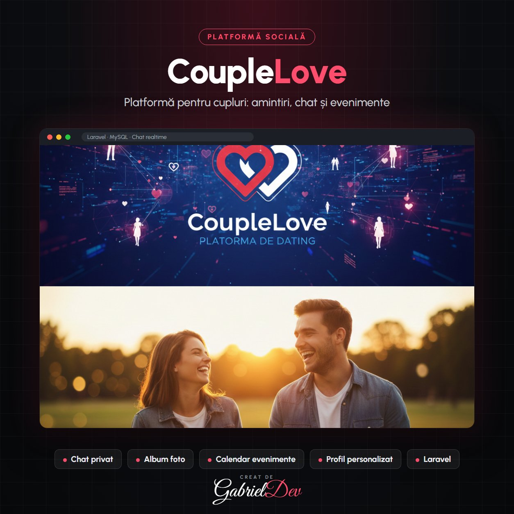

  

<h1 align="center">CoupleLove</h1>

CoupleLove este o platformă modernă de dating creată pentru a conecta persoane compatibile într-un mediu sigur și intuitiv. Proiectul combină funcționalități complexe de socializare cu un design simplu și atractiv, oferind utilizatorilor o experiență plăcută de navigare și interacțiune.

| | |
|---|---|
| **Client** | Client privat |
| **An** | 2025 |
| **Domeniu** | Backend Development · Frontend Development · Aplicații Web Personalizate |
| **Status** | Livrat (site-ul nu mai este online) |
| **Studiu de caz** | [gabrieldev.eu](https://gabrieldev.eu/portofoliu/couplelove) |

---

#### Descriere

CoupleLove este o aplicație dedicată cuplurilor care doresc să își creeze un spațiu digital personal. Proiectul se concentrează pe interacțiune emoțională, partajarea momentelor speciale și crearea unui loc privat unde amintirile sunt păstrate pentru totdeauna.

#### Key Features

- Album Foto: Cuplurile pot încărca, organiza și partaja amintiri vizuale într-un mod elegant.
- Chat Privat: Secțiune dedicată comunicării în timp real între parteneri.
- Calendar de Evenimente: Cuplurile pot planifica aniversări, evenimente și activități.
- Personalizare Profil: Teme, imagini și texte adaptate stilului fiecărui cuplu.

#### Technologies Used

- Front-End: Blade Template + CSS modern pentru o estetică romantică.
- Back-End: Laravel pentru gestionarea profilurilor, chat și media uploads.
- Database: MySQL pentru stocarea amintirilor și mesajelor.

#### Design Highlights

- Tematică Romantică: Culori pastel, iconografie delicată și atenție la detalii.
- Navigare Simplă: Totul este creat pentru a facilita comunicarea emoțională.
- Responsivitate Totală: Experiență excelentă pe mobil.

---

## 🔒 Despre cod

Acesta este un repository de **prezentare**. Codul sursă aparține clientului și nu este public — aici găsești descrierea proiectului, funcționalitățile și tehnologiile folosite.

## 🤝 Ai nevoie de ceva asemănător?

Proiect realizat de **[Gabriel Dev](https://gabrieldev.eu)** — creare site-uri, magazine online și aplicații web personalizate.

- 🌐 [gabrieldev.eu](https://gabrieldev.eu) · [toate proiectele](https://gabrieldev.eu/proiecte)
- ✉️ [contact@gabrieldev.eu](mailto:contact@gabrieldev.eu)
- 📞 [+40 743 543 100](tel:+40743543100)
